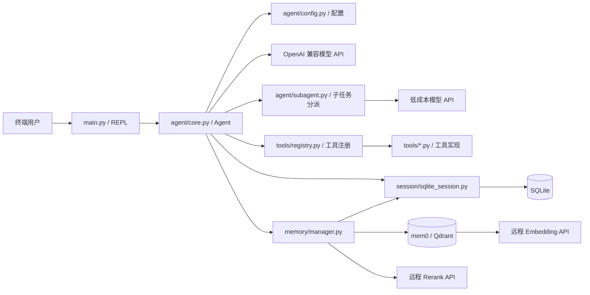
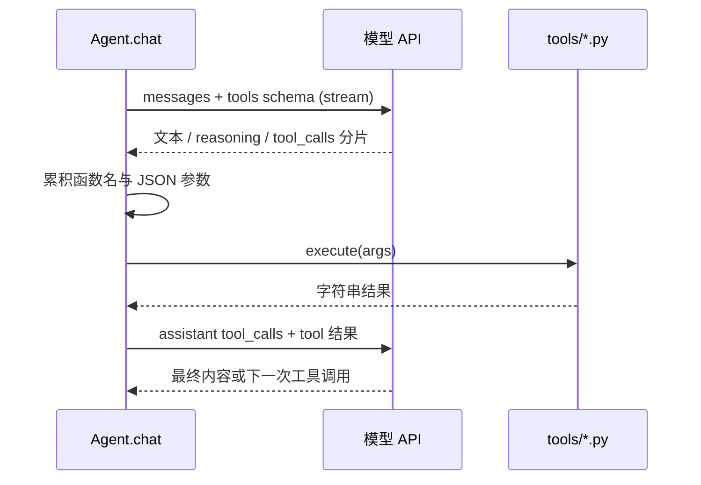

# Naga Agent 设计文档（基于当前实现）

本文描述当前仓库的实际实现，不将 README 中的旧设计视为已实现功能。运行方式参见 [README](../README.md)；代理开发约定参见 [AGENTS.md](../AGENTS.md)。下文的“设计”指现有代码中的职责与数据流，已知缺陷单列，不代表期望行为。

## 1. 系统概览

本项目是 Python 终端交互代理：本地 CLI 接收用户输入，通过 OpenAI 兼容接口进行流式推理与函数调用，保存会话，并按配置结合长期记忆、技能提示词和远程嵌入/重排服务。它不是 Web 应用；模型 API、Qdrant 和网页搜索属于进程外部依赖。

### 启动与单轮请求

1. `main.py` 加载配置，打开 SQLite 会话存储，选择或创建会话，再构造 `Agent`。`Agent` 发现工具、按配置决定是否初始化记忆和启动嵌入 daemon、初始化低成本子任务执行器、扫描 `skills/`；当前配置关闭长期记忆。
2. CLI 先处理 `/` 内置命令；普通输入交给 `Agent.chat()`。该方法保存用户消息，读取历史，拼接系统提示词、核心/情景记忆、技能和运行状态，直接调用当前主模型，不做预分类。
3. 主模型按需调用现有工具，或调用 `delegate_tasks` 分派独立简单任务。子 Agent 使用低成本模型与独立上下文，仅有只读工具；其结果作为工具消息返回主模型继续推理。流式回复可同时包含正文、思考内容与分片函数调用。
4. 完成后将助手文本写入 SQLite，累计主模型 token 用量；子 Agent 使用量单独记录。满足记忆提取间隔时后台提取情景记忆。

## 2. CLI 与代理主流程

| 模块 | 职责与关键功能 | 边界 |
| --- | --- | --- |
| `main.py` | Rich + prompt_toolkit 交互界面；选择会话；处理 `/help`、主模型/分派/思维链、提示词、技能、会话、token 和清空命令；首轮后台生成会话名。 | 用户输入与展示在此完成；普通请求委托给 `Agent.chat()`。 |
| `agent/core.py` | 构造每轮请求与状态；主模型流式调用、工具执行、按需分派、会话与用量写入。 | 工具通过 registry 获取，子任务委托 `SubtaskRunner`，持久化委托 `SessionManager`，记忆委托 `MemoryManager`。 |
| `agent/subagent.py` | 顺序处理主模型指定的小任务；为每个任务构造独立消息、调用低成本模型，最多使用只读工具若干轮。 | 不读取主会话、不执行写入/命令、不再分派；结果返回主模型，usage 单独写入。 |

`Agent` 在首位 system prompt 中仅加入固定配置和代码规则及 `<theme>...</theme>` 标签协议。所有 Skill 的原始 frontmatter 始终作为参考目录注入；自动匹配的 Skill 正文受 token 限额约束，显式指定则注入入口文件全文，放不下时明确报错。核心/情景记忆、主题、动态运行状态和历史摘要以带标签的低信任参考消息提供，不提升工具结果为 system 指令。工具 schema 独立于消息优先计入预算。每轮首先由主模型处理，仅在它主动调用 `delegate_tasks` 时使用低成本模型；子任务结果由主模型审阅并完成最终答复。

持久化包括用户/助手消息、完整工具调用批次及结果、token 记录、按来源 ID 界定的摘要。工具调用批次在完成后原子写入；修改消息历史、工具调用或提示词结构时，应同时检查上下文预算和会话恢复的影响。

## 3. 配置、分派与上下文

| 模块 | 功能设计 | 输入、输出与注意点 |
| --- | --- | --- |
| `agent/config.py` | 合并 `.env`、环境变量、`config.toml` 与代码默认值，形成传给 CLI 和 Agent 的嵌套字典。 | `NAGA_DB_PATH` 可覆盖数据库路径；`OPENAI_API_KEY` 回退到 `DASHSCOPE_API_KEY`；`OPENAI_BASE_URL` 优先于 TOML 中的 `model.base_url`；`AGENT_SYSTEM_PROMPT` 优先于提示词文件及内联内容。 |
| `config.toml` | 模型列表/专属参数、分派预算、工具限额、Agent UI 与提示词、MCP server、技能、记忆及可选嵌入 daemon 的部署配置。 | Qdrant 为外部服务 (`localhost:6333`)；远程 Qwen3 Embedding 和 Reranker 不需本地 daemon。模型自带联网搜索被禁用，联网由配置的 MCP server 提供。 |
| `agent/subagent.py` | 提供 `delegate_tasks` schema，按任务各自调用低成本模型，仅可请求已注册的 `read_file`。 | 默认每次最多 3 个任务、每任务 3 轮只读工具、主对话最多分派 2 次；参数从 `[delegation]` 配置且受到上限约束。 |
| `agent/context_window.py` | 解析模型元数据中的上下文大小；以服务地址和模型名作为缓存键写入 `.context_window_cache.json`。 | 优先级：正数人工覆盖、已确认的缓存、模型元数据、默认回退值 131072（128k）；若模型窗口小于回退值须手动配置。失败探测仅缓存 60 秒，不从模型名或报错推断。 |
| `agent/token_tracker.py` | 估算消息/工具 schema token、利用 API usage 渐进校准估算系数，并将真实消耗按模型写入会话存储。 | 优先尝试 tiktoken 编码；不可用时字符粗估。`get_session_summary()` 统计本会话输入/输出及调用次数，不是计费金额。 |
| `agent/skill_registry.py` | 扫描 `skills/*.md` 或 `skills/*/SKILL.md`，解析简化 frontmatter，提取关键词/示例并收集目录资源清单。 | 非通用 YAML 解析器；`skills.enabled` 非空时覆盖文件中的 `enabled`，否则按文件字段决定。目录不存在时返回空列表。 |

`Agent` 会构造用户约束、当前步骤、已读 Skill 文件和工具派生信息等参考状态块，按配置限制条目数与字符数；后续请求可恢复部分上轮状态。技能文件放入 `skills/` 后可通过 CLI 或 `skill_manager` 工具启停；以 `/{skillname}` 开头只选取指定的已启用 Skill，普通请求仍自动匹配。`_match_skills()` 按 frontmatter 关键词与示例打分，并应用 `match_top_k` / `min_match_score`；停用的 Skill 不可被选取。

`Agent` 在组装请求时按探测到的窗口预留生成空间和工具 schema 大小。固定 system 和最新用户轮次优先；记忆只占剩余空间的最多 10% 且不超过 2048 token，过长条目跳过。默认保留最近 30 批工具调用及其结果，当前用户轮次的批次全部保留；较早批次在预算判断与压缩之前成对剔除，不写入摘要。流式思维链从不持久化或回送给模型。输入超过可用预算的 75% 时，按完整旧轮次生成带来源消息 ID 的有界摘要，保存至 SQLite；原文不删除，恢复时从最后覆盖 ID 继续增量读取。其余按 token 估算和 `max_history` 保留近期轮次；过长工具输出只截断发送副本。主子模型共享预算算法，正向模型窗口缓存一天后重新核验；`/token` 展示最近窗口、schema、输入估算和摘要进度。

## 4. 会话与记忆

| 模块 | 功能设计 | 持久化/失败语义 |
| --- | --- | --- |
| `session/sqlite_session.py` | `SessionManager` 为各线程创建独立 SQLite 连接，打开 WAL 和外键开关；管理会话增删改查、按 ID 增量读取消息、token 用量、摘要覆盖边界和核心记忆 KV。 | `messages.metadata` 保存附加 JSON，读取时合并进消息；写操作显式 commit。数据库路径来自配置。 |
| `memory/manager.py` / `memory/local.py` | 核心层缓存 SQLite 记忆；情景层可使用本地 SQLite 文件和关键词匹配，或经 mem0 调用 Qdrant、embedding 和 rerank。 | 关闭时不初始化或注入长期记忆；本地模式仅主动保存，无自动提取；mem0 初始化失败时核心记忆仍可工作。 |
| `tools/memory.py` | 对外提供 `layer=core|episodic` 与 `action=save|recall|delete|list`，委托 `MemoryManager`。 | 核心记忆不提供 recall；情景层检索方式取决于后端。关闭长期记忆时工具不暴露。 |

会话 SQLite 的表为 `sessions`、`messages`、`token_usage`、`summaries`、`memories`。会话消息按自增 ID 排序；用户/助手文本及完成的工具调用链、输出均保留原文。长期记忆默认在当前配置中关闭；启用 `local` 时，核心和情景记忆存放于独立 SQLite 文件，按英文词及中文相邻字符匹配，不自动提取，不使用向量服务。启用 `qdrant` 时核心记忆存放于会话数据库，情景记忆由 mem0 管理；提取间隔由 `extract_every_n_turns` 控制。不同后端数据不会自动迁移。关闭记忆不影响会话历史和摘要。

`summaries` 的 `get_summary()` / `set_summary()` 为旧接口；新摘要使用 `get_summary_record()` / `set_summary_record()` 并保存 `last_message_id`。迁移旧数据库时保留文本，覆盖 ID 默认为 0；只有新摘要具备可验证的恢复边界。

## 5. 工具协议与实现

`tools/registry.py` 启动时扫描 `tools/` 内的 Python 模块，导入后读取 `TOOL_DEFINITION` 和 `execute(args)`，向模型提供 OpenAI 函数 schema。`delegate_tasks` 由 `agent/subagent.py` 定义，在启用且配置了子模型时由 `Agent._select_tools()` 增加。普通工具按 `execute(args)` 调用；`execute_command` 在 `Agent._call_tool()` 中单独注入交互确认、超时和输出限额。

| 模块 / 工具名 | 输入与行为 | 限制和副作用 |
| --- | --- | --- |
| `tools/execute_command.py` / `execute_command` | 接收 `command`、`description`，用子进程 shell 执行；命中黑名单直接拒绝，高风险关键字即使自动确认开启仍要求确认。 | 默认超时按配置；合并 stdout/stderr 并截断返回；规则为正则匹配而非完整安全隔离，不应执行不可信命令。 |
| `tools/read_file.py` / `read_file` | 接收路径与可选的 1-based 起止行，返回类型、行范围和 UTF-8 文本。 | 输出正文最多 64000 字符，支持继续分段读；相对路径按当前工作目录解析。 |
| `tools/mcp.py` / `mcp` | 按 `list` 查看已配置的 server/tool 目录，指定 `tool` 查看参数 schema，按 `call` 转发工具参数；支持 stdio 与 Streamable HTTP。 | 默认输出最多 64000 字符，超限提示；仅配置并启用 server 时暴露；HTTP header 支持 `${ENV_VAR}`；缺少变量时拒绝请求。由 MCP 服务端决定具体工具权限。 |
| `tools/memory.py` / `memory` | 操作两层记忆，支持保存、查询/列表与按 ID 删除。 | 核心层容量有限；情景层取决于 mem0、Qdrant 和嵌入服务可用性。 |
| `tools/skill_manager.py` / `skill_manager` | `list` 列出、`enable/disable` 启停、`reload` 重扫描已有 Skill。 | 不创建、替换或删除 Skill 文件；进程内启停状态在重新扫描后仍保留。 |
| `agent/subagent.py` / `delegate_tasks` | 接收任务数组，每项包含任务描述及可选背景；子 Agent 顺序执行、返回分项结果及状态。 | 无共享历史、无嵌套分派；工具结果按上下文预算控制，每项最终结果最多 64000 字符，超限提示。未配置子模型时不暴露。 |

### 工具调用时序

当调用的是 `delegate_tasks`，`Agent` 将任务交给 `SubtaskRunner`，后者分别向低成本模型发送独立请求，必要时使用只读工具；返回的汇总 JSON 作为一条 `tool` 消息回到主模型。子任务顺序执行而非并行，以控制资源占用和隔离副作用。

## 6. 交互功能与代理内部机制

### CLI 命令

| 命令 | 当前效果 |
| --- | --- |
| `/help`、`/quit`、`/exit` | 查看帮助或结束 REPL。 |
| `/model <名称>`、`/model auto`、`/delegate on/off` | 切换主模型或恢复默认主模型；当前进程内开关低成本任务分派。 |
| `/thinking on/off`、`/thinking show/hide` | 前者改写模型请求扩展参数，后者控制推理内容的终端显示。 |
| `/confirm on/off` | 控制命令工具的常规确认；高风险命令仍强制确认。 |
| `/prompt`、`/prompt set <内容>`、`/prompt clear` | 查看或临时改变当前进程中的系统提示词，不写回配置文件。 |
| `/session`、`/session new/list/switch <N>` | 查看当前会话、创建新会话、展示最近 10 个会话或按序号切换。 |
| `/token`、`/history`、`/clear` | 查看用量、查看最近消息摘要、确认后删除会话消息。 |
| `/skill list/on/off` | 查看并切换内存中的技能启用状态；技能文件由扫描器发现。 |

`main.py` 在新会话首次对话后用后台线程向模型请求短标题并更新会话名。底部状态栏显示最近一次发送请求的消息及工具 schema 总估算，不读取持久化历史作为上下文用量；`/token` 另外显示 API 返回的最近真实输入。已被裁剪的旧历史和预留输出空间不计入已用输入。`memory/main.py` 是重复的 CLI 入口文件；项目常规入口仍为仓库根目录的 `main.py`。

### Agent 单轮内部设计

- **上下文组装**：读取会话历史，生成 system prompt、记忆、技能以及单独的运行状态消息；提取用户显式约束、当前目标、步骤和工具发现，以有界文本延续上下文。每轮从新的用户输入重置状态，符合跟进请求特征时恢复部分上一轮状态。
- **模型请求**：使用当前模型的专属 `extra_body`；`reasoning_effort`、`max_completion_tokens` 进入顶层参数。流式收集 `reasoning_content`、正文和按索引分片的 `tool_calls`。若多个 system 消息被兼容 API 以 4xx 拒绝，`skill_layer_mode=auto` 会合并 system 后重试一次。
- **主题跟踪**：模型回复开头的 `<theme>` 标签只用于更新进程内会话主题，不作为正文输出；主题可参与下一轮记忆查询。没有正确闭合标签时输出原始缓冲内容。
- **分派与执行**：主模型进入工具循环，自行判断是否调用 `delegate_tasks`；每次最多分派配置数量的独立任务，每轮主对话有单独分派上限。子模型异常按任务返回错误，其余任务仍可继续。
- **子 Agent 权限**：子任务上下文仅含任务描述与背景，可使用注册表中的只读工具，不读取主模型历史或调用写工具；任何工具调用有轮次上限。
- **持久化**：用户输入在模型请求前写库，最终助手内容经 Markdown 简化后写库；终端返回的是原始输出。主模型流式 usage 和子模型每次 API usage 分别记录到会话，用量统计涵盖已返回 usage 的请求。

## 7. 本地服务、独立脚本与项目文件

| 文件/模块 | 当前设计与用法 |
| --- | --- |
| `scripts/vector_daemon.py` | FastAPI + sentence-transformers 服务；启动时检查或下载 `models/bge-base-zh-v1.5`，加载模型后提供 `GET /health`、`POST /embed`、OpenAI 兼容的 `POST /v1/embeddings`。编码向量归一化；启动参数含 host、port 和 CPU 线程数。 |
| `scripts/download_model.py` | 独立的模型预下载/`--check` 脚本；按清单尝试 ModelScope、hf-mirror，已有完整文件跳过，失败退出。daemon 也有自己的下载及回退到 SentenceTransformer 在线下载逻辑。 |
| `generated_scripts/my_personality_prompt.txt` | 当前 `config.toml` 默认读取的系统人格与行为提示词；其中部分旧版记忆工具语法和自动压缩描述与当前代码不一致，变更功能时需同步修订。 |
| `generated_scripts/sakuya_personality_prompt.txt` | 仓库中的另一份可选人格文本，未被当前配置选用。 |
| `generated_scripts/install_redis_gui.py` | 独立的跨平台 Redis GUI 安装向导：检测操作系统，下载到用户 Downloads 并提示安装；主代理并不依赖 Redis。 |
| `generated_scripts/redis_cli.py` | 独立的交互式 Redis 客户端，支持 get/set/delete/keys/type/ttl/hash/list 等操作；需要另外安装 `redis` 包并有 Redis 服务，未被主代理导入。 |
| `generated_scripts/setup_ollama.sh` | 独立的 Ollama 安装、启动和模型拉取脚本；含远程安装脚本执行，不是主程序的启动前置步骤。 |
| `requirements.txt` | 主程序、mem0/Qdrant、FastAPI、sentence-transformers、DDG 等依赖声明；不是辅助 Redis CLI 的完整依赖清单。 |
| `.env.example` | 主模型 API、可选 Bocha 搜索与子模型名称/独立地址/密钥示例。实际 `.env` 不应纳入版本控制。 |
| `agent/__init__.py`、`memory/__init__.py`、`session/__init__.py`、`tools/__init__.py` | 空的 Python 包标记，不承担运行时逻辑。 |
| `README.md`、`AGENTS.md` | 分别面向使用者的操作说明和编码代理的仓库规则；本文件面向架构理解与后续设计维护。 |

### 服务与数据位置

| 项目 | 默认位置 | 生命周期 |
| --- | --- | --- |
| SQLite | 仓库根目录 `naga.db`（可由 `NAGA_DB_PATH` 改写） | 跨会话长期保存，启动时初始化表。 |
| Qdrant | `localhost:6333` | 进程外部服务；情景记忆不应与 SQLite 核心层混淆。 |
| 嵌入与重排 | 远程 OpenAI 兼容 API | 仅 Qdrant 记忆模式使用；`VECTOR_API_KEY` 优先，否则复用主模型 Key；`/v1/rerank` 不可用时保留向量排序。daemon 仅在 Qdrant 模式且单独配置脚本路径时启动。 |
| 上下文窗口缓存 | `.context_window_cache.json` | 从模型元数据取得窗口后落盘，按 base URL + 模型区分。 |
| 生成脚本 | `generated_scripts/` | 工具执行后留在磁盘；需注意同名覆盖和脚本权限。 |

## 8. 已知实现差异与风险

1. **SQLite 迁移（已修复）**：`SessionManager._init_db()` 仅在已有 `messages` 表缺少 `metadata` 列时执行 `ALTER TABLE`；新库直接使用建表定义。回归测试覆盖新库初始化、旧消息保留与重复启动。
2. **说明滞后**：README 中仍保留 Chroma、旧的工具数量与机械压缩说明；当前实现为 Qdrant、8 个自动注册工具 + 按需分派工具，并不执行历史压缩。默认人格提示词也包含旧记忆 API 和压缩承诺。
3. **安全与隔离**：工具可执行 shell、修改本地文件、访问任意 HTTP(S) URL；正则黑名单、交互确认和输出截断并不是沙箱。加载/卸载 Skill 或生成脚本涉及软链接、覆盖或删除目标，自动确认默认开启。使用外部输入时需额外考虑路径、重定向与命令权限。
4. **外部依赖与验证**：完整 CLI 依赖模型 API，情景记忆还依赖 Qdrant 和嵌入服务；`tests/` 包含 SQLite 与分派的离线回归测试，尚无配置的 lint 流程。子 Agent 的真实提供商兼容性需要独立的在线集成验证。

## 9. 维护指引

- 调整 CLI 命令：同时核对 `main.py` 的帮助文本、命令分支和 `memory/main.py` 的重复内容；确认切换会话后读取、清空仍使用当前会话 ID。
- 调整配置：核对 `config.toml`、`agent/config.py` 的默认值与消费者，区分“解析了配置字段”和“运行时实际使用了字段”。
- 调整工具：在 `tools/` 内遵守函数 schema + `execute(args)`，检验自动注册及模型侧调用；有交互或全局状态时检查 `Agent` 的特殊分发和初始化注入。
- 调整持久化：先定义表迁移和兼容策略，再用空库、已存在库、不同线程连接核验；记忆的核心层与情景层应分别测试。
- 调整代理策略：覆盖主模型流式响应、分片工具调用、子任务上下文隔离、错误回传、分派预算与 token 统计；更新本文件和 README 中受影响的说明。